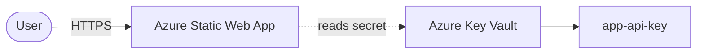

# Azure Static Web App + Key Vault (Terraform)

> A globally served static site on Azure Static Web Apps, with secrets stored in Azure Key Vault (RBAC) — provisioned with Terraform.
> **Author:** Muhammad Ahmad · **IaC:** Terraform · **Cloud:** Azure


---

## 📌 Overview

- **Azure Static Web Apps** hosts the front end on a global CDN with free SSL and a deployment token.
- **Azure Key Vault** (with **RBAC authorization**) stores application secrets — here a generated `app-api-key`.
- The Static Web App's deployment token is exposed as a sensitive output for CI wiring.

## 🏗️ Architecture

> 🎨 **Interactive diagram (industry-standard icons):** [open in Lucid — page 17](https://lucid.app/lucidchart/3da75ce3-ea66-4296-81b3-00d20a60435b/edit)



## 🚀 Deploy

```bash
cd terraform
az login
terraform init
terraform apply

terraform output static_web_app_url
```

Use the `static_web_app_api_key` output as your SWA deployment token in CI.

## 🧹 Clean up

```bash
terraform destroy
```

## 💰 Cost note

Static Web Apps **Free** tier and a **Standard** Key Vault are low/no cost — ideal for small production sites.

## 🔐 Production hardening (next steps)

- Grant the app a **managed identity** with *Key Vault Secrets User* and read secrets at runtime.
- Add a **custom domain** + managed certificate.
- Enable Key Vault **purge protection** and soft-delete in production.

---

*Built and maintained by **Muhammad Ahmad**.*
