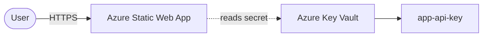

# Architecture Diagram — Azure Static Web App + Key Vault

## Lucid diagram

- **View:** https://lucid.app/lucidchart/92c1352d-f148-48cc-a69d-e371e0eeb64e/view
- **Edit:** https://lucid.app/lucidchart/92c1352d-f148-48cc-a69d-e371e0eeb64e/edit

## Lucid prompt (reusable)

```
Create an Azure architecture diagram titled "Azure Static Web App + Key Vault".
A User connects over HTTPS to an Azure Static Web App (global CDN). The app reads a
secret (app-api-key) from Azure Key Vault using RBAC. Label the arrows. Clean,
professional Azure colors.
```

## Mermaid source


